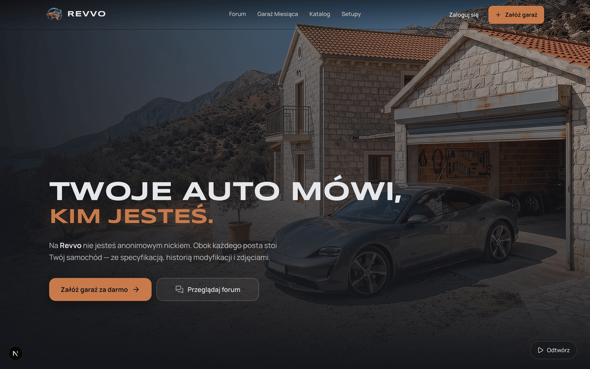
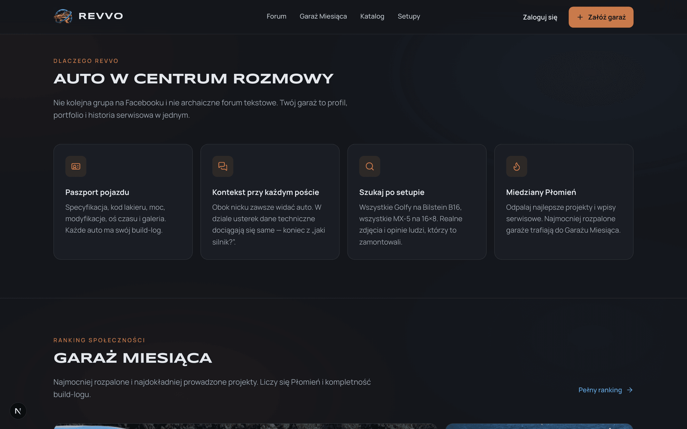
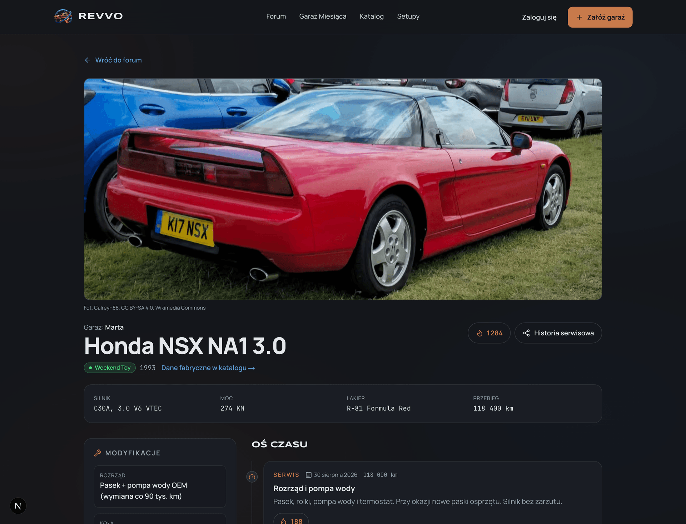
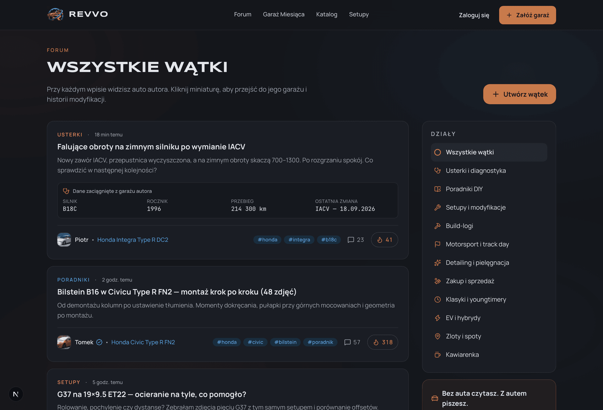
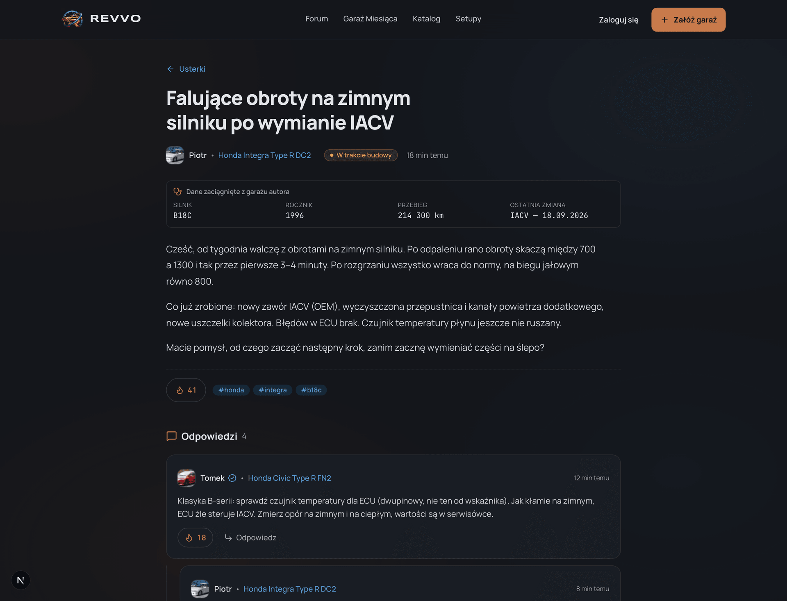
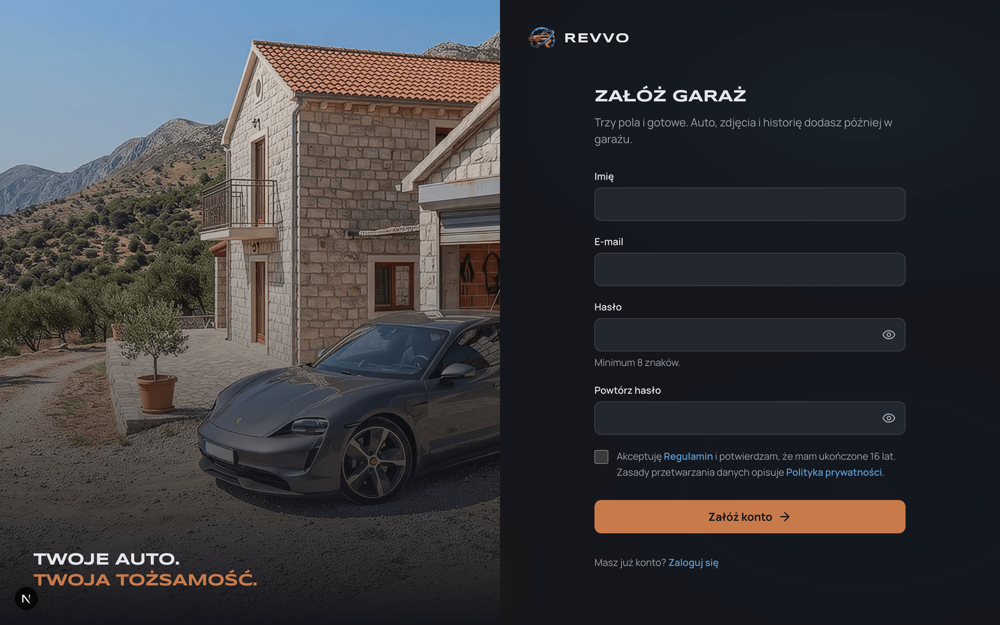
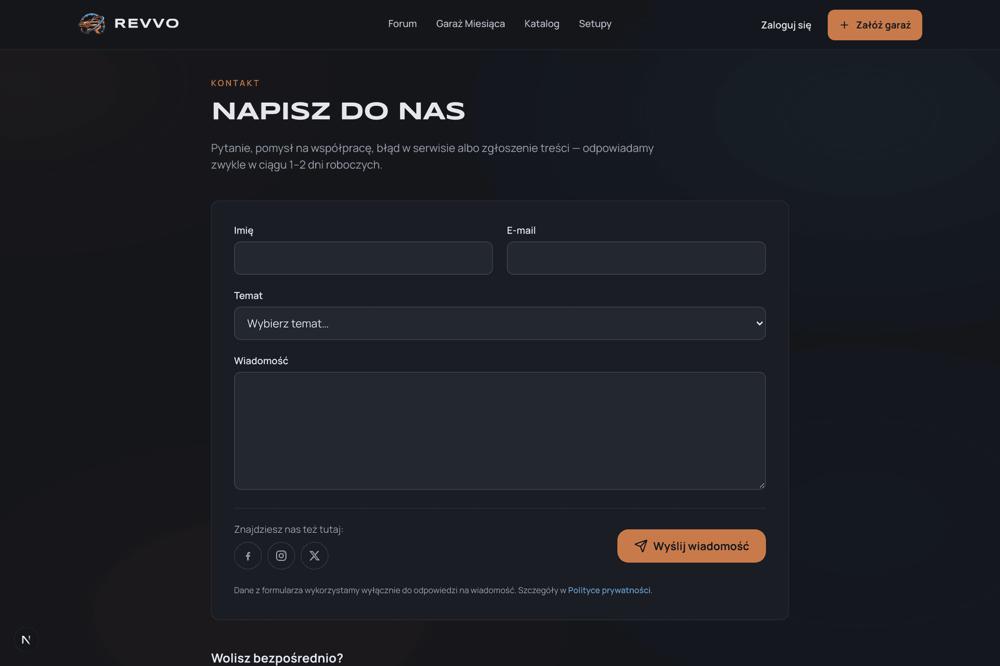

<div align="center">


### A next-generation car forum built around a Virtual Garage

*"Your car says who you are."*

[Polski](README.md) · **English**

[](https://nextjs.org/)
[](https://react.dev/)
[](https://www.typescriptlang.org/)
[](https://tailwindcss.com/)
[](https://www.postgresql.org/)
[](https://orm.drizzle.team/)
[](https://www.cloudflare.com/products/r2/)

[About](#-about-the-project) • [Screenshots](#-app-preview) • [Key pillars](#-key-pillars) • [Architecture](#-architecture-and-tech-stack) • [Quick start](#-quick-start) • [Folder structure](#-folder-structure)

</div>

---

## 📌 About the project

**REVVO** is a modern social platform for car enthusiasts that solves the biggest pain points of traditional
discussion forums and Facebook groups. The app is in Polish.

On traditional social media knowledge gets lost in the noise, and every technical discussion starts with endless
questions: *"Which engine? Which year? What's been modded?"*.

In **REVVO** the center of a user's identity is **the car (or a collection of cars)**, not an anonymous avatar. Every
profile is an interactive **Virtual Garage** with a full vehicle passport, a modification timeline and a reliable
service history.

### 🌟 Why REVVO?

1. **No more technical anonymity** - next to every post and comment there is a badge with the author's car, linking
   directly to its spec.
2. **Automatic context for faults** - when you create a thread in the diagnostics section, the system automatically
   attaches a snapshot of your car (engine code, year, mileage, latest mods).
3. **A knowledge base built on setups** - want to know how an 18×8.5 ET35 wheel sits, or how Bilstein B16 coilovers
   perform? Search by specific parts and see real photos and owner opinions.
4. **The engagement rule** - anyone can read, but to post and build the community you need to add at least one car to
   your garage.

---

## 📸 App preview

### 1. Home page with interactive video and a depth effect
*A hero with a dynamic background video of a car leaving a garage and a custom depth effect.*



---

### 2. Platform pillars and Garage of the Month
*The platform's differentiators: Vehicle passport, Post context, Setup search and the Copper Flame gamification system
with a ranking of the best builds.*



---

### 3. Virtual Garage - vehicle passport and build log
*A complete car card: factory specs integrated with the catalog, status (Daily, Build in progress, Weekend Toy, Track
project), a list of mods, a mods/service timeline and a Copper Flame counter.*



---

### 4. Discussion forum with categories
*11 specialized sections. In the thread list every author is tagged with a car from their garage.*



---

### 5. Thread view with an automatic car snapshot
*A thread in the diagnostics section with the author's car spec card pulled in automatically and a threaded
discussion.*



---

### 6. Join the community - sign-up
*Fast, minimal onboarding centered on the passion for cars.*



---

### 7. Contact and help
*A dedicated contact form with topic selection and support integration.*



---

## ⚡ Key pillars

### 🚗 Virtual Garage (digital passport & build log)
- **Vehicle card:** paint code, engine, factory power, mods grouped into categories (engine, suspension, exhaust,
  wheels, interior).
- **Timeline:** a chronological record of mods, repairs, track visits and photo shoots, with mileage.
- **Project statuses:**
  - 🔵 **Daily** - an everyday car
  - 🟠 **Build in progress** - an active garage project
  - 🟢 **Weekend Toy** - a weekend car / classic
  - 🔴 **Track project** - a machine prepared for track days / motorsport
- **Public service history link:** transparent proof of the modification history and care for the car when selling it.

### 💬 A forum with built-in technical context
- **11 specialized sections:**
  - *Faults and diagnostics* (attaches a car snapshot)
  - *DIY guides* (step-by-step manuals with photos)
  - *Setups and mods* (what fits, what rubs and how it drives)
  - *Build logs* (project diaries from purchase to finish)
  - *Motorsport and track day* (lap times, track prep)
  - *Detailing and care* (corrections, coatings, PPF)
  - *Buying and selling* (buying guides, verification)
  - *Classics and youngtimers*, *EVs and hybrids*, *Meets and spots*, *Café*.
- **Threaded comments:** a clear reply hierarchy with a preview of each commenter's car.

### 🔥 Copper Flame and Garage of the Month
- A unique community recognition system (`#C87A4B` Copper Flame).
- You can "light a flame" for a whole project or for a specific, impressive service entry on the timeline.
- An automatic algorithm picks the **Garage of the Month** for the home page based on entry quality and community
  engagement.

---

## 🛠 Architecture and tech stack

| Layer | Technology | Description |
|---|---|---|
| **Frontend framework** | **Next.js 16 (App Router)** | The latest Next.js with Cache Components, Turbopack, SSR/SSG for good SEO of threads and garages |
| **UI library** | **React 19** | Modern server (RSC) and client components, React `<ViewTransition>` |
| **Styling & design system** | **Tailwind CSS v4** | Custom REVVO v2 palette (graphite `#14161B`, copper `#C87A4B`, cobalt `#5B9BD5`), full WCAG AA compliance |
| **Typography** | **Syncopate + Manrope + JetBrains Mono** | A bold display face for headings, a readable sans for content and monospace for technical data |
| **Icons** | **Lucide React** | A consistent vector set |
| **Backend & API** | **Next.js Server Actions + Route Handlers** | Domain architecture (`src/server/...`), ready for modular growth |
| **Database** | **PostgreSQL** | Relational database handling catalog relations, threaded comments and mod indexes |
| **ORM & migrations** | **Drizzle ORM** | Type-safe database schema, SQL migrations with `drizzle-kit` |
| **Media storage** | **Cloudflare R2** | S3-compatible storage with zero egress costs for car photos and attachments |
| **Image processing** | **Sharp** | Compression to modern WebP/AVIF formats with automatic responsive variants |
| **Security & anti-spam** | **Cloudflare Turnstile** | CAPTCHA verification on forms, invisible to the user |

---

## 📁 Folder structure

```text
Revvo/
├── docs/                     # Project documentation and screenshots
│   └── screenshots/          # Generated interface screenshots (Retina)
├── logo/                     # Official brand assets (SVG vectors, PNG, WebP)
├── package.json              # Root npm shortcuts for running project commands
└── web/                      # Main Next.js app
    ├── .env.example          # Template of safe environment variables
    ├── drizzle/              # Drizzle ORM database migrations
    ├── drizzle.config.ts     # Drizzle ORM configuration
    ├── next.config.ts        # Next.js 16 configuration (Cache Components, images, remote patterns)
    ├── scripts/              # Data import scripts (seed, car2db catalog, photo download)
    └── src/
        ├── app/              # App Router routes (home, forum, garages, catalog, auth)
        ├── components/       # Reusable UI components (navigation, cards, video player, badges)
        ├── lib/              # Helpers, data types, mock data
        └── server/           # Backend logic (db connection, catalog queries, categories)
```

---

## 🚀 Quick start

### Prerequisites
- **Node.js** `v20.x` or newer (`v22+` recommended)
- **npm**, **pnpm** or **yarn**
- A running **PostgreSQL** instance (local, in Docker or a cloud service like Neon/Supabase)

### 1. Clone the repository
```bash
git clone https://github.com/szymonkaczmarczyk/revvo.git
cd revvo
```

### 2. Configure environment variables
Go to the web app folder and create a `.env` file from the template:
```bash
cp web/.env.example web/.env
```
Then fill in `web/.env` with your data (PostgreSQL connection details, Cloudflare R2 keys and a random string for
`AUTH_SECRET`, among others).

### 3. Install dependencies
```bash
cd web
npm install
```

### 4. Database: migrations and seeding
Apply the prepared table migrations to PostgreSQL and seed the database with the base car catalog and forum
categories:
```bash
npm run db:migrate
npm run db:seed
```

The source car catalog (`baza-danych/`), original videos (`background/`), source photos (`content/`) and the design
system (`design-system/`) are local only and are not in the repository. `npm run db:seed` needs the `baza-danych/`
folder next to `web/`.

> **Tip:** You can open Drizzle Studio in the browser to inspect the database structure and content:
> ```bash
> npm run db:studio
> ```

### 5. Start the dev server
Start the Next.js dev server (from the root or from `web/`):
```bash
# From the project root:
npm run dev

# Or directly from web/:
cd web && npm run dev
```

The app will be available at **[http://localhost:3000](http://localhost:3000)**.

---

## 📜 Available npm scripts

| Command (in `web/` or from the root) | Description |
|---|---|
| `npm run dev` | Starts the Next.js dev server (Turbopack) on port 3000 |
| `npm run build` | Builds an optimized production version of the app |
| `npm run start` | Starts the built app in production mode |
| `npm run lint` | Checks the code with ESLint |
| `npm run db:generate` | Generates a new SQL migration after changes in `schema.ts` |
| `npm run db:migrate` | Applies pending migrations to PostgreSQL |
| `npm run db:seed` | Fills the database with the model catalog and forum sections |
| `npm run db:seed:demo` | Adds 4 demo accounts with cars and timelines (Marta, Piotr, Tomek, Kasia), can be repeated |
| `npm run db:studio` | Opens the Drizzle Studio GUI to browse data |
| `npm run test:e2e` | Runs end-to-end tests (Playwright, desktop and mobile) |

---

## 🧪 E2e tests

A Playwright suite in `web/e2e/` (`*.e2e.ts` files), run in two viewports: desktop 1440×900 and a phone (Pixel 7). It
checks:

- every subpage: status 200, one H1, `lang="pl"`, meta title and description, no horizontal scroll, no console errors,
- accounts: sign-up (validation, duplicate email, confirmation link), login with a return to the `next` URL, HttpOnly
  cookie, logout, lockout after 5 wrong passwords, password reset (the link works once), changing name and password,
  account deletion,
- the garage: photos (upload, cover, gallery, rejecting fake and too-small files), the car wizard from the catalog, a
  manually entered car, validation, editing, main car, deletion, protection against editing someone else's car,
- the forum, catalog, contact form and SEO (unique titles, Open Graph, `robots.txt`, `sitemap.xml`, `favicon.ico`,
  404 page).

Tests run on a separate server (port 3100) with Cloudflare Turnstile test keys and emails saved to `web/.mailbox/`
instead of being sent through Resend. The easiest way is a production build in the `.next-e2e` folder:

```bash
cd web
export NEXT_DIST_DIR=.next-e2e STORAGE_DRIVER=local EMAIL_TRANSPORT=file NEXT_PUBLIC_APP_URL=http://localhost:3100 NEXT_PUBLIC_TURNSTILE_SITE_KEY=1x00000000000000000000AA TURNSTILE_SECRET_KEY=1x0000000000000000000000000000000AA
npm run build && npm run start -- --port 3100
```

In a second terminal:

```bash
npm run test:e2e
```

Without a running server Playwright starts `next dev` on port 3100 with the same variables (slower). Test accounts
(`e2e-…@example.com`) are deleted after the tests. A database with the catalog and demo data is required
(`npm run db:seed` and `npm run db:seed:demo`). On the first run: `npx --prefix web playwright install chromium`.

---

## 🔒 Security and data privacy

- All private configuration, session tokens and API keys are stored in `.env` and are **excluded from the
  repository** by `.gitignore` rules.
- The repository contains only the safe configuration template `web/.env.example`.
- User passwords are hashed with **Argon2id**. Sessions are stored in the database (only a random token goes into an
  `HttpOnly`, `Secure`, `SameSite=Lax` cookie, the database holds its SHA-256 hash), valid for 30 days from the last
  visit.
- Sign-up and password reset are protected by Cloudflare Turnstile, a bot trap and attempt limits. Login locks after 5
  wrong passwords in 15 minutes.
- Every car change checks on the server that the car belongs to the logged-in user. Security headers (CSP, HSTS,
  `X-Content-Type-Options`, `Referrer-Policy`, `Permissions-Policy`, `frame-ancestors`) are set in `next.config.ts`.
- Test reports (`playwright-report/`, `test-results/`, `coverage/`) and local assistant logs are filtered out by
  `.gitignore`. The e2e test suite (`web/e2e/*.e2e.ts`) stays in the repository.

---

## 📄 License

The project code is released under the MIT license. Full text in [LICENSE](LICENSE).

The MIT license does not cover the Revvo name and logo (`logo/`, `web/public/brand/`), the site's background video or
the car photos from Wikimedia Commons, which have their own licenses (CC BY, CC BY-SA, CC0) stored in the database with
each photo.

---

<div align="center">

Built with a passion for cars and modern web development.

**REVVO © 2026 Szymon Kaczmarczyk** · MIT license

</div>
